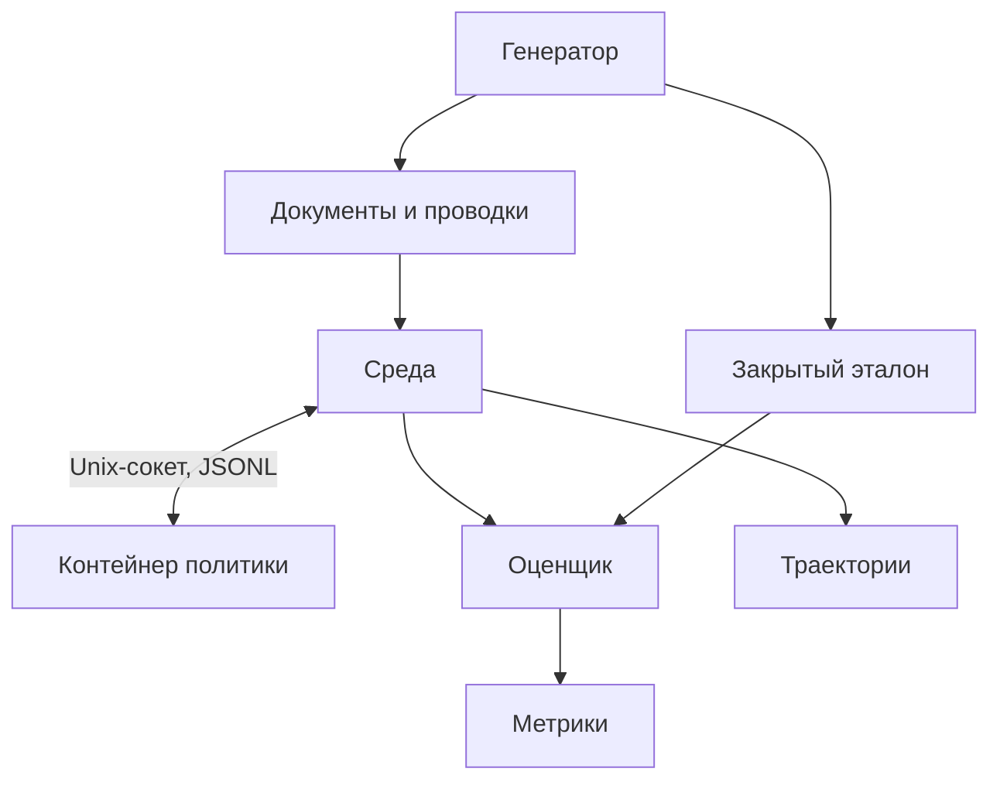

# Архитектура Genesis FinTech

Genesis выдаёт синтетический отчётный период компании. Политика исследует документы и проводки, отправляет выводы со ссылками на доказательства, а оценщик независимо выставляет результат. [Контракт G0](CONTRACT_G0.md)

## Данные и доказательства

Генератор из `src/genesis_audit/data/` строит сбалансированный журнал и затем вносит обратимые изменения. Версия, seed и конфигурация определяют эпизод. В открытом корпусе 10 train и 10 dev эпизодов, включая чистые случаи и сочетания ошибок. Проверка из `src/genesis_audit/verification/` пересчитывает суммы и проверяет, что откат каждой мутации убирает именно её расхождение. [Структура корпуса](../episodes/README.md)

| Доступно через среду | Только на стороне оценки |
|---|---|
| Манифест, правила периода и FX, журнал, счета, платежи, курсы | `truth.json`, происхождение мутаций и семена генерации |

## Контракт и изоляция

Внешний интерфейс — `judge_adapter.py`. `generate_episode` создаёт файлы, `make_env` выдаёт объект с `reset/step`, `score_episode` считает метрики и награду. Политика может запросить страницу записей, отдельную запись, документ, десятичное вычисление или отправить результаты.

Среда выдаёт до 50 записей на страницу и ограничивает эпизод 100 действиями и 60 секундами. В режиме closed публичная награда всегда равна 0. В train финальное действие возвращает награду. Код политики и доверенный раннер запущены в двух контейнерах без сети. Контейнер политики работает с непривилегированным UID, файловой системой только для чтения и доступом к каталогу сокета. [Проверка изоляции](../sandbox/README.md)

## Оценка и воспроизведение

Оценщик проверяет структуру ответа, затем строит взаимно однозначное сопоставление по типу, ID, сумме, валюте и доказательствам. При равных максимальных сопоставлениях выбирается лексикографически первое. Награда равна `clip(2 × F1 − 1 − 0.002 × inspection_steps, −1, 1)`.

`bash scripts/verify.sh` прогоняет тесты, четыре базовые политики и дополнительную сверку с агрегацией. Результаты сохраняются в `artifacts/`. Зафиксированы версии контейнера и корпуса, порядок записей воспроизводим. [Отчёт о проверке](ROLE_C_HANDOFF.md)
