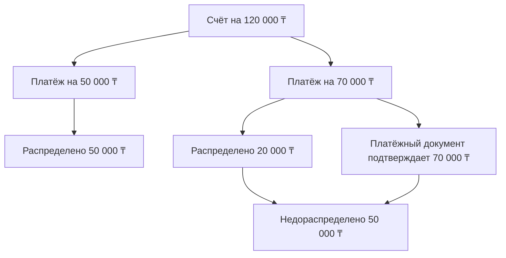
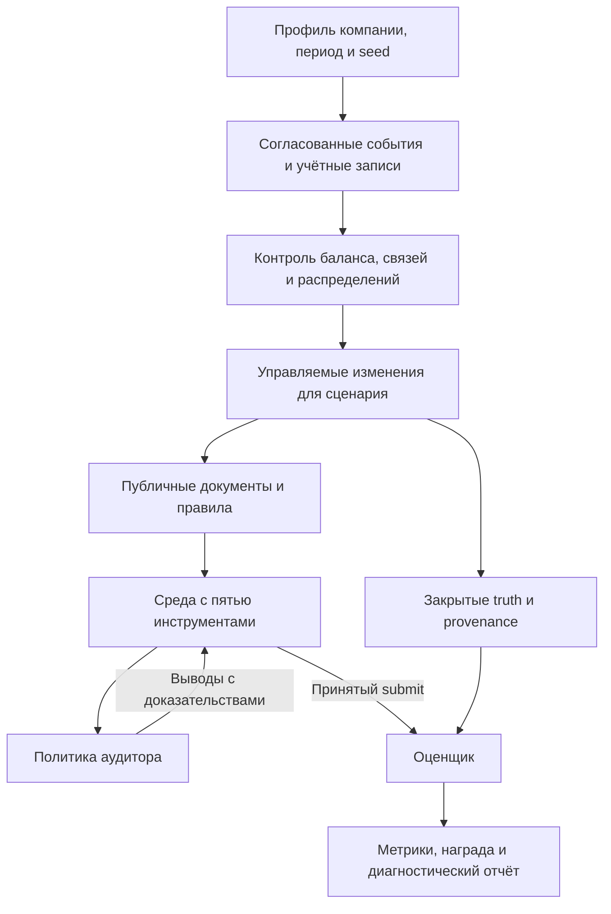
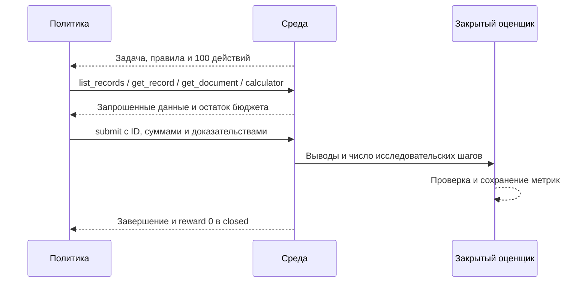
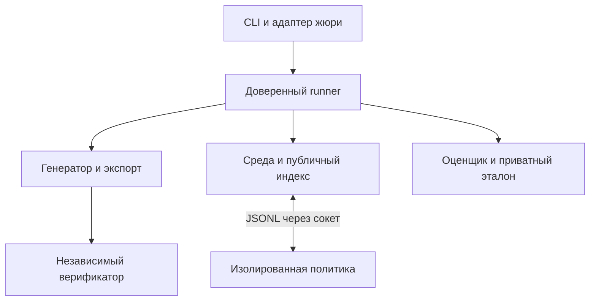

# Архитектура Genesis FinTech
Контракт роли C зафиксирован в [CONTRACT_G0.md](CONTRACT_G0.md). Текущую реализацию и границы выполненной проверки см. в [ROLE_C_HANDOFF.md](ROLE_C_HANDOFF.md).

## Как читать проект

**На входе** одна вымышленная компания, отчётный период и набор сценариев. **На выходе** воспроизводимый эпизод, инструменты расследования, журнал действий и независимая оценка качества. Один и тот же эпизод может пройти скрипт или обученная модель. Жюри оценивает свойства всей среды.

| Что проверяет жюри | Баллы | Что показываем |
|---|---:|---|
| Контракт и изоляция | 25 | 20 проверок интерфейса, лимитов и доступа к данным |
| Данные и эталон | 25 | 20 эпизодов с проверяемыми расхождениями и чистыми случаями |
| Надёжность награды | 25 | 20 проверок, включая дубли, ложные выводы и пограничный ввод |
| Воспроизводимость | 15 | 20 пар эпизодов с перестановкой и согласованной заменой ID |
| Инженерия | 10 | Запуск одной командой, версии, траектории, измеренный сбой и ограничения |

По кейсу сдаём генератор, среду, оценщик, тесты, четыре адаптера политик, 10 train и 10 dev эпизодов, траектории, документацию, контейнер и демо. Обучение модели опционально.

## Что обязательно по кейсу и спецификации

| Источник | Что сделать | Как проверяем |
|---|---|---|
| Кейс §02–03 и D01–D20 | Генерировать согласованный учёт, независимо включать четыре типа ошибок и описать два сочетания. Сделать пять чистых сценариев, включая корректные разделённые платежи и возвраты | По каждому эпизоду независимый верификатор восстанавливает состояние до мутации, пересчитывает изменение и подтверждает наличие полного публичного набора доказательств |
| Кейс §04 и C01–C20 | Реализовать пять действий и JSON-контракт. В closed загружать переданный каталог. Соблюдать 50 записей на страницу, 100 действий и 60 секунд от начала reset, включая время политики | Тестировать pagination, ошибки, повторный reset, submit на шаге 100, truncation с пустыми findings и изоляцию. Проверка ОС выполняется на Linux |
| Кейс §05 и R01–R20 / M01–M12 | Проверять структуру и лимиты до нормализации, затем искать максимальное паросочетание с опубликованным tie-break и считать общую награду | Сопоставить полученный ответ с ожидаемыми TP/FP/FN и reward. Отдельно проверить чистый пустой ответ, дубли, массовую пометку и неизвестные ссылки |
| Кейс §06 и P01–P20 | Поддержать повтор исходного эпизода и загрузку преобразованных файлов | 5 перестановок, 5 замен ID, 10 сочетаний. После обратного отображения oracle должен дать те же выводы и оценку при одинаковом числе шагов |
| Кейс §07–10 и инженерные критерии | Собрать воспроизводимый офлайн-пакет, сохранить 20 открытых эпизодов, траектории, инструкции и диагностику | Прогнать полный комплект из чистого checkout. Зафиксировать версии, показать измеренный сбой и повтор исправления либо воспроизводимый предел |

Формат сдачи включает **четыре адаптера**: случайный исследователь с фиксированным seed, простая сверка, массовая пометка и oracle. Локальное демо может использовать скрипт сверки. На закрытом прогоне жюри использует **свои одинаковые политики** на 20 скрытых эпизодах. Наш адаптер переводит формат, поля и типы, сохраняя решения политики. Oracle строит эталонные findings внутри доверенного процесса и отправляет их обычным submit. Награды политик нужны для диагностики, итоговые баллы начисляются по блокам среды.

## Почему задача сложная

У компании есть счёт на 120 000 ₸ и два платежа на 50 000 и 70 000 ₸. Две оплаты здесь нормальны. Если второй платёж проведён в банке целиком, а в учёте к счёту распределено только 20 000 ₸, расхождение составляет 50 000 ₸. Книга при этом может оставаться сбалансированной: остаток учитывается отдельно как нераспределённый платёж. Аудитор должен доказать вывод по документам и записать сумму с ID. Генератор должен гарантировать, что все документы, необходимые для такого вывода, доступны в пределах бюджета действий.

Для KZT с exponent 2 агент отправляет `claimed_amount_minor=5000000`. `affected_ids` задают объект и записи, которые задела конкретная ошибка. `evidence_ids` указывают, какие публичные документы и строки доказывают вывод. Канонический набор для каждого типа фиксируем до реализации.

## От хозяйственного события к оценке

Генератор создаёт хозяйственные события и их представление в учёте. Мутация меняет конкретное представление: например, добавляет вторую группу проводок для одного обязательства. Верификатор отдельно проверяет исходный учёт, фактическое изменение и достаточность публичных доказательств. Оценщик сравнивает находки агента с эталоном посредством максимального паросочетания, чтобы один вывод или повтор не принёс балл за несколько ошибок.

| Файл | Содержание | Кто получает |
|---|---|---|
| `manifest.json`, `policy.json` | Период, timezone, размер, базовая валюта, разрядность, округление и правило FX | Политика при reset |
| `ledger.csv` | Дебет, кредит, время, валюта и связи с операциями | Политика через инструменты |
| `invoices.jsonl`, `payments.jsonl` | Счета, платежи и документированные основания распределений | Политика через инструменты |
| `fx.csv` | Дата, направление валютной пары, курс в виде десятичной строки | Политика через инструменты |
| `truth.json` | Тип, сумма, валюта, затронутые ID и допустимые наборы доказательств | Оценщик |
| `provenance.json` | Исходное состояние и упорядоченные изменения до/после | Оценщик и верификатор |

Эпизод охватывает одну компанию и один период. Ориентир кейса составляет 200–2 000 проводок, 20–200 документов и 0–12 ошибок. Документы и справочные данные, нужные для операций на границе периода, должны оставаться доступны. Чистые сценарии включают разделённые платежи, возвраты, совпадающие суммы и корректный FX на границе периода.

| Сценарий | Что меняется | Что доступно для пересчёта |
|---|---|---|
| Дубль счёта | Две группы учёта одного обязательства | Исходный счёт и обе группы записей |
| Пропуск или частичное распределение | Назначение платежа и учётное распределение расходятся | Платёж, счёт, сумма назначения и проводки |
| Неверный курс | Учёт применил неверную дату или курс | Сумма и валюта операции, дата, FX-таблица, правило и проводка |
| Неверный период | Дата признания расходится с правилом | Хозяйственная дата, дата признания, границы и timezone |
| Распределение + FX | Недораспределение и ошибочный курс на отражённой части | Например, из 100 USD распределены 80 USD. Недораспределение равно 20 USD, FX-расхождение при 490 вместо 500 KZT/USD равно 800 KZT на 80 USD |
| Дубль + период | Повтор отражения и неверный период у исходной группы | Например, обязательство на 120 000 KZT отражено дважды, а исходная группа стоит на день раньше границы. Оба вывода имеют отдельные основания, их суммы не складываются в общий ущерб |

Числа в таблице иллюстрируют проектные правила. G0 закрепляет знак, валюту, ID и достаточные доказательства для каждой ошибки. Если корректное правило периода требует независимой даты хозяйственного события, она должна быть на публичном документе.

## Где использовать генератор R3n0va

Репозиторий с лицензией MIT документирует детерминированную генерацию, связанные таблицы, двойную запись и помесячные курсы к EUR. Его модель охватывает бухгалтерскую фирму и её клиентов. Пригодность вывода для отдельного периода Genesis пока не проверена запуском. [Исходный репозиторий](https://github.com/R3n0va/synthetic-accounting-data-generator)

| Проверка перед выбором | Условие принятия |
|---|---|
| Воспроизводимость | Один зафиксированный commit, отключённые DQ-инъекции, одинаковые seed/config дают одинаковое нормализованное содержимое |
| Срез компании и периода | Сохраняются связи счёта, платежа, распределения и обеих сторон проводки, включая обоснованные ссылки на соседние периоды |
| Семантика | Сходятся двойная запись, валюты, суммы и распределения. Существуют даты и документы для независимой проверки четырёх типов |
| FX | Помесячные курсы подходят только для явно описанного правила. Для нужного сценарию изменения курса используются отдельные синтетические даты и курсы Genesis, без выдуманной точности в исходных данных |
| Поставка | Сборка и зависимости фиксируются, MIT-уведомление сохраняется при копировании, официальный запуск работает без сети |

На T00 выделяем до 90 минут на проверку исходника и малого примера. Если связи не сохраняются либо их восстановление требует догадок, выбираем компактный собственный генератор. Оба варианта выдают одну внутреннюю модель событий. Экспорт, мутации, truth и verifier в обоих случаях принадлежат Genesis. Это решение изолирует внешний формат от среды и оценщика.

## Как эпизод проходит от reset до оценки

Закрытый runner хранит эталон. Политика исполняется в отдельном ограниченном процессе и получает только разрешённые наблюдения. В train итоговая награда доступна после submit. В closed даже правильный ответ возвращает политике 0, а реальные метрики остаются у оценщика. Submit входит в 100 действий, включая возможность отправки на шаге 100, но не входит в штрафуемые исследовательские шаги. Проверки времени учитывают работу политики.

## Чем выделиться

1. **Контрфактическая пара.** Для открытого демо создать два эпизода с одинаковой исходной историей и почти одинаковыми документами. В одном split-payment корректный, во втором допущено частичное распределение. Показать, какое конкретное свидетельство меняет вывод.
2. **Проверяемая цепочка доказательств.** В закрытом отчёте показать исходное событие, изменение, независимый пересчёт, ID доказательств и результат matcher. На демо оценщик может проверить каждое звено.
3. **Тест устойчивости.** Переставить строки и согласованно заменить ID. После обратного отображения эталонные находки и оценка совпадают при равных шагах. Для политики дополнительно показать изменение качества и ложных срабатываний, даже если порядок её действий изменился.

## Как улучшать и проверять модель

Под моделью здесь понимается политика, которая выбирает действия и формирует `submit`. Первая версия — воспроизводимый скрипт сверки. Его вариант с проверкой доказательств становится более сильным baseline: локальные индексы по ID уменьшают лишние обращения, Decimal проверяет суммы, правило периода использует timezone, а отсутствие полного набора доказательств приводит к отказу от конкретного обвинения. Это проверяемые гипотезы: индексы должны сократить шаги, а проверка доказательств — снизить FP, возможно ценой recall.

| Этап | План |
|---|---|
| Обязательный baseline | Seeded random, простая сверка, массовая пометка и evaluator-only oracle. Oracle задаёт проверку достижимой оценки |
| Улучшенный скрипт | Сравнить простую сверку с той же политикой после добавления проверки доказательств. Фиксировать параметры и одинаковые бюджеты |
| Опциональное обучение | Обучить небольшую политику ранжирования действий или кандидатов на CPU. Вход — публичные признаки и история чтения, цель — решения учителя на train. Приватный scorer допустим для отбора train-траекторий, его выводы исключены из входных признаков |
| Опциональный RL | После imitation baseline попробовать терминальную награду в train. Сохранить официальную формулу, журналировать расход действий. Если награда слишком редкая и эксперимент не даёт повторяемого прироста, оставить воспроизводимый baseline |
| Проверка результата | 10 публичных train и 10 публичных dev для сдачи. Для собственного эксперимента отдельно сгенерировать дополнительные train и замороженный held-out из других компаний, seed и сочетаний. Группировать связанные эпизоды и их копии в одном split. Hold-out открывать после выбора политики по dev |

На одних и тех же held-out эпизодах сравнить исходный скрипт, усиленную сверку и обученный вариант при одинаковых лимитах, с версиями и seed. Отчёт включает число эпизодов, TP/FP/FN, F1, итоговую награду, FP на чистых, полноту по типам и взаимодействиям, долю находок с полным доказательством, шаги, время и тайм-ауты. Считать разницу по парам эпизодов и показать, где новый вариант проигрывает. Не менять настройку после просмотра hold-out. Прирост можно заявлять после измерения, а диагностика модели остаётся отдельной от баллов среды.

### Что понадобится, если команда решит обучать веса

1. **Рабочая среда и данные.** Генерировать дополнительные train-эпизоды из разных исходных компаний с чистыми случаями и всеми типами ошибок. Зафиксировать список train/dev и отдельного финального held-out. Разные версии одной истории и её копии с новыми ID держать в одном split. Сдаваемые 10 train + 10 dev остаются комплектом для проверки.
2. **Наблюдения и действия.** Сделать небольшой выбор следующей проверки, например «сверить следующий счёт», «открыть связанный платёж» или «завершить аудит». Доступные варианты формируются из публичных записей, уже выполненных запросов и оставшегося бюджета. Каждый выбор выполняется через настоящие шаги среды. Расчёт денег, составление доказательств и формат submit оставить в Python. Вход модели не содержит truth, seed, приватные метрики или идентификатор сценария.
3. **Данные учителя для imitation.** Записать из сильной скриптовой сверки пары «публичное состояние → выбранное действие». Обучить маленький классификатор или ранжировщик на CPU. Это самостоятельный вариант обучения с учителем. Если пример выбрал приватный оценщик, он может отобрать эпизод только на train. Следующее действие учителя должно быть доступно из записанного публичного состояния.
4. **RL как отдельный эксперимент.** Тренер вне среды запускает много train-эпизодов, сохраняет состояния, действия, итоговую награду и признаки окончания. Стартовая политика может быть взята из imitation. Простой вариант для первого прогона — дискретный policy gradient на допустимых действиях с итоговым возвратом эпизода. Промежуточная награда равна 0. Оптимизатор обновляет веса между прогонами, среда выполняет действия и считает награду.
5. **Проверка.** Сначала выбрать модель и настройки по dev, затем заморозить веса и сравнить её с исходной скриптовой сверкой на одних held-out эпизодах. Использовать одинаковые 100 действий и 60 секунд, фиксировать версии, seed, P/R/F1, возврат, FP на чистых эпизодах, шаги и время. Оценку вычислять на доверенной стороне. Сохранить конфиг, код тренера, веса и отчёт. Для опционального эксперимента использовать CPU без платных API.

---

## Технический контракт для реализации

## Стек и среда разработки

**Python 3.11 на Linux** для генератора, среды, оценки, политик и тестов. **VS Code на Windows с расширениями WSL и Python** для разработки в Ubuntu. Интерпретатор в IDE — Python 3.11 из проектного `.venv` внутри WSL. Если WSL у команды недоступен, подойдёт Ubuntu VM с тем же Python и Docker. Для тестов на Windows допустим локальный Python 3.11, а проверку контейнера и границы между процессами проводим в Linux.

| Компонент | Выбор | Зачем |
|---|---|---|
| Основной код | Python 3.11, `dataclasses`, `typing`, `csv`, `json`, `decimal`, `datetime`, `zoneinfo`, `random`, `hashlib` | Единый язык и готовые средства для точных денег, сериализации и повторяемой генерации |
| Максимальное паросочетание | Увеличивающие пути и отдельный лексикографический выбор | Малый эталонный граф и запуск без внешних библиотек |
| Локальные тесты | `unittest`, Python 3.11 | Табличные случаи с ID критериев, фикстуры и отдельные группы тестов |
| Проверка сдачи | Docker Compose на Linux, образ доверенного проверяющего процесса и отдельный образ политики | Повторяемое окружение и проверяемая граница доступа |
| Протокол между контейнерами | JSONL через Unix-сокет в отдельном общем томе | Обмен сообщениями без сети и без доступа к каталогу эпизода |
| Конфигурация | `pyproject.toml`, `requirements-runtime.lock`, `requirements-dev.lock` | Сборка и запуск по фиксированным зависимостям |

`requirements-runtime.lock` и `requirements-dev.lock` фиксируют ноль внешних Python-зависимостей для G0. Базовый образ задан в Dockerfile. Сборка получает образ заранее. Официальный запуск идёт из подготовленных образов без сети. Эксперименты по ML получают отдельный набор зависимостей после готовности сдачи. [VS Code WSL](https://code.visualstudio.com/docs/remote/wsl)

## Какой код можно взять с GitHub

| Источник | Что берём | Что остаётся сделать в Genesis |
|---|---|---|
| [R3n0va](https://github.com/R3n0va/synthetic-accounting-data-generator) · [MIT](https://github.com/R3n0va/synthetic-accounting-data-generator/blob/main/LICENSE) | Малый профиль и генерацию связанных счетов, оплат и двойных записей через штатный генератор. В T00 фиксируем commit и находим фактические точки входа в исходниках и CLI | Адаптер чистой истории, фильтрация периода с сохранением ссылок, точные суммы, публичный экспорт, четыре мутации и независимая проверка. DQ источника выключаем. По результату проверки выбираем внешний источник или компактный собственный |
| [Gymnasium core.py](https://github.com/Farama-Foundation/Gymnasium/blob/main/gymnasium/core.py) · [контракт Env](https://gymnasium.farama.org/api/env/) | Сигнатуры `reset`/`step` и идею раздельных `terminated`/`truncated`. Чистый Python-класс с контрактом жюри позволяет обойтись без установки Gymnasium | Собственное состояние, бюджет, формат наблюдений, режимы и submit |
| [CPython](https://github.com/python/cpython/tree/3.11/Lib) | Готовые API `csv.DictReader`, `json.loads`, `Decimal`, `zoneinfo.ZoneInfo`, `random.Random`, `hashlib.sha256`, `time.monotonic` | Правила учёта, преобразования, контролируемые ошибки и контракт ввода |

Пакеты подключаем обычным импортом. Если потребуется перенести исходный код, фиксируем commit, путь, свою правку и лицензию в `THIRD_PARTY_NOTICES.md`. Для R3n0va сохраняем MIT-уведомление. Пути функций генерации и пригодность выгрузки уточняем после чтения конкретной ревизии и малого запуска.

Для R3n0va начни с опубликованного CLI `accounting-data-generator generate`, профиля `config/profiles/smoke.yaml` и сценария `config/scenarios/baseline.yaml`. Через `show-config` проверь, что эффективная конфигурация действительно выключает DQ. Путь к точке входа бери из `pyproject.toml` выбранной ревизии. Это позволяет сначала проверить данные и решить, достаточно ли CSV-адаптера.

**Как выбираем matching.** Увеличивающими путями считаем максимальную мощность `K`. Среди допустимых пар берём первую лексикографически, после которой оставшийся граф позволяет получить ещё `K - 1` пар. Удаляем её вершины и повторяем. Реализацию сравнили с полным перебором на всех графах размером 3×3.

## Обязательные требования реализации

| ID | Что реализуем | Приёмка |
|---|---|---|
| REQ-01 | Файлы эпизода и схемы по §03. Согласованные документы, четыре ошибки, два взаимодействия и чистые случаи | D01–D20, независимый пересчёт |
| REQ-02 | Адаптер жюри, пять действий и лимиты. Closed загружает переданный пакет, train умеет его генерировать | C01–C20, проверка Linux и тайм-аута |
| REQ-03 | Строгая валидация, уникальное сопоставление с официальным tie-break, TP/FP/FN и формула награды | R01–R20, M01–M12 и малые графы |
| REQ-04 | Воспроизводимый seed и стабильные ссылки. Поддержка внешней перестановки и замены ID | P01–P20, равная оценка при равном числе шагов |
| REQ-05 | Четыре адаптера политик, 10 train и 10 dev эпизодов, траектории и диагностика | Запуск комплекта, E01–E05 |
| REQ-06 | Python 3.11, проверка на CPU без сети, инструкция сборки и ограничение процесса политики | Чистая сборка, runtime без сети, 2 CPU и 4 ГБ на прогон согласно лимитам кейса |

Дополнения после обязательного комплекта: сравнение чистого и ошибочного эпизода, отчёт причин и доказательств, усиленная скриптовая сверка. Обучение политики остаётся экспериментом. Баллы по прежней матрице [ACCEPTANCE_MATRIX.md](ACCEPTANCE_MATRIX.md).

## Как устроено хранилище

**База эпизода — каталог CSV/JSONL/JSON, публичный индекс в оперативной памяти.** Генератор готовит комплект в доверенном каталоге. При `reset` загрузчик проверяет версии схемы, типы значений и связи, затем строит индекс. На масштабе эпизода хватает списков и словарей Python. Поставка обходится без отдельного сервера базы. Если команде понадобится SQL для ручных запросов, локальный отчёт может импортировать только публичные таблицы в SQLite из стандартного Python. Этот импорт остаётся отдельным инструментом разработчика.

| Что храним | Как читаем | Владелец |
|---|---|---|
| Публичные счета, платежи, проводки и FX | Read-only списки по таблицам для страниц. Словари `RowID → row`, `DocID → document` и `(date, source_currency, target_currency) → rate` | `env/episode_store.py` |
| Манифест и правила | Схема и публичные правила, сериализуемые перед выдачей | `contracts/` и `env/episode_store.py` |
| Историю мутаций и истины | Отдельное чтение `truth.json` и `provenance.json` по доверенному пути | `scoring/` и `verification/` |
| Остаток шагов, курсоры, финал | Состояние конкретного `AuditEnv`; заново при каждом reset | `env/audit_env.py` |
| Журнал и отчёт | JSONL действий и публичных наблюдений. Приватные результаты в отдельном отчёте | `runner/` внутри доверенной части |

Списки сохраняют порядок файлов, индекс не меняет ID. `get_record` и `get_document` получают записи из памяти и возвращают независимые JSON-снимки, чтобы вызывающий код не мог изменить книги. Курсор обозначает позицию в таблице и живёт в текущем эпизоде. Загрузчик читает известные имена файлов, никакой пользовательский ID не используется как путь. Для `episode_dir` загрузчик принимает предоставленные записи без сортировки, генерации, смены ID и исправления содержимого.

## Где идут тесты и как задаются seed

| Где | Что запускаем | Что фиксируем |
|---|---|---|
| Локально, Python 3.11 в VS Code или терминале | `bash scripts/check.sh` | G0, matcher, reward и стыки runner. Для времени подставляем управляемые часы |
| Linux, сборка Docker Compose | `docker compose build` после реализации Dockerfile и compose | Версии Python, образа и зависимостей. Установка зависит от заранее доступных пакетов |
| Linux, полный проверочный прогон | `bash scripts/verify.sh` после подготовки образов | Группы тестов, сквозной прогон, проверка доступа, фактический watchdog и комплект артефактов. Сеть runtime отключена |
| Опциональная CI | На Linux runner повторить локальную команду и контейнерный прогон до сдачи | Версии, сценарии, результаты и сохранённые логи |

Команды описывают будущий проект. Контейнерная группа создаёт тестового участника, который проверяет видимые пути и отсутствие доступа к файлу с тестовым маркером оценщика. Дополнительно она проверяет отдельный процесс, запрет сети, независимость журналов и остановку зависшей политики. Unit-тесты с подменой часов нужны для пограничного поведения и не заменяют проверку настоящего процесса.

Seed задаёт воспроизводимую случайность. **Параметры теста определяют сценарий, а seed меняет его числа и ID.** Поэтому проверка частичной оплаты гарантированно включает эту ошибку.

1. Локальный `tests/fixtures/cases.json` хранит `case_id`, `scenario_config`, `episode_seed`, `transform_seed` и при необходимости `policy_seed`. Для ручных задач вроде matcher используем маленькие фиксированные записи. Для D/P — матрицу 20 конфигураций и преобразований.
2. Генератор получает `episode_seed` и независимые генераторы случайности для истории, мутаций и порядка. Например, seed каждого потока выводится из SHA-256 от канонически сериализованных полей. Встроенный `hash()` для этого не используется. Порядок обхода данных задаётся явно.
3. В тесте повтора два запуска используют одинаковые версии, конфиг и seed. Сравниваем каноническое содержимое, последовательность наблюдений при тех же действиях и оценку. Тайминги храним в отчёте, их побитового равенства не требуем.
4. В тесте преобразований копия эпизода переупорядочивается или получает новые ID по `transform_seed`. Проверяем целостность ссылок, а затем оценку семантически того же ответа с тем же числом шагов. В closed внешние файлы считаются входом, свой seed для их замены не используется.
5. Открытые train/dev и собственный held-out разводим по исходным компаниям и семействам преобразованных копий. Скрытые кейсы жюри приходят отдельно. В закрытом прогоне seed и результаты не передаём политике. Seed и версии пишем в отчёт доверенной части для воспроизведения.

`pyproject.toml` задаёт маркеры `container` и `slow`. Локальные тесты пишут во временные пути с `tmp_path`. Полный прогон собирает фактические результаты по ID критерия, журналы и диагностический отчёт.

## Обязательные точки входа
В judge_adapter.py:
- generate_episode(seed: int, config: dict, output_dir: str) -> None
- make_env() -> объект reset/step
- score_episode(episode_dir: str, findings: dict, inspection_steps: int) -> dict

reset(seed, config) -> (observation, info).
step(action) -> (observation, reward, terminated, truncated, info).
Closed reset: config={"mode":"closed","episode_dir":"...","team_config":{...}}; загрузить переданный комплект без перегенерации. Train без episode_dir использует генератор с seed/team_config.
Пути и аргументы reset доступны только доверенному контроллеру, не политике.

Начальное observation: task, manifest, policy, remaining_steps=100.
Последующее: result, error, remaining_steps.
Action envelope: {"name":"list_records|get_record|get_document|calculator|submit","args":{...}}.
list_records: table,cursor,limit → records,next_cursor; максимум 50.
get_record: table,id; get_document: doc_id; calculator: expression → decimal string.
submit args: {"findings":{"episode_id":"...","findings":[...]}}. Публичный результат: accepted=true либо ограниченная ошибка структуры, без оценки совпадений.
Структура finding: type, affected_ids, claimed_amount_minor, currency, evidence_ids, explanation.

## Граница доверия
Доверенный контроллер содержит генератор, загрузчик episode_dir, env state, scorer и приватные файлы. Отдельный broker выдаёт только разрешённые ответы через IPC.
Политика запускается в отдельном OS-ограниченном процессе/контейнере с read-only кодом политики; без монтирования episode_dir и кода оценщика, без Docker socket, host PID namespace, лишних capabilities, сети и writable evaluator mounts.
Нужна реальная граница UID/mount namespace/контейнера. Папка рядом с кодом и private-поле Python недостаточны. Локальный trusted adapter может быть библиотечным, но политика не импортирует его; общение только по ограниченному протоколу.
На Linux два сервиса Compose обмениваются JSONL через Unix-сокет. Доверенный `verify` слушает сокет и проверяет размер и схему сообщений. Контейнер политики подключается как клиент. Они разделяют только том IPC. Эпизоды и журналы оценщика примонтированы только в `verify`. У обоих сервисов `network_mode: none`, Docker socket недоступен. Скрипт на хосте запускает сервисы через Compose, берёт код завершения `verify` и останавливает свою группу контейнеров, включая зависшую политику. Supervisor оценщика фиксирует timeout и заканчивает сеанс сразу по дедлайну. Приёмку этой схемы выполнить в T03 на Linux.
Генерация и скоринг не выполняются внутри policy-контейнера. Oracle — исключительный адаптер оценщика: строит findings доверенно и подаёт submit через тот же контракт, не даёт чтение truth обычным политикам.
Публичные и приватные траектории раздельны. Все сообщения с исключениями формируются через allowlist кодов; никакого raw traceback/пути/config в response.

## Файловая схема эпизода
Имена обязательных публичных файлов: manifest.json, ledger.csv, invoices.jsonl, payments.jsonl, fx.csv, policy.json.
Закрытые: truth.json и provenance.json. Классификация доступа определяется загрузчиком/монтажом, не только именем.
Форматы и обязательные поля — из §03 первоисточника. CSV null-конвенцию документировать явно и преобразовать в JSON null через API.
Схемы фиксируются до работы агентов. Дополнения ledger/event/allocation должны иметь публичное семантическое описание.

Деньги: int minor + exponent валюты из manifest/policy. При конвертации учитывать exponent обеих валют:
target_minor = round((source_minor / 10**source_exp) * rate * 10**target_exp).
FX rate — Decimal из строки; policy фиксирует направление source→target, дату и округление. Не считать все валюты двухзначными молча.
Даты aware; период предварительно [start,end) в timezone manifest; дата FX выводится строго по policy. Это предлагаемые решения, которые команда должна опубликовать.

## Восстановимость данных
provenance содержит версию генератора, приватную исходную историю либо полный обратимый patch до/после, порядок мутаций и причинные связи.
Truth вычисляется по зарегистрированным семантическим изменениям и проверяется независимым verifier по документам.
Канонические affected_ids каждого типа задаются в публичной документации до оценки; дополнительные строки «на всякий случай» не проходят. Валюту и знак ожидаемой суммы определить явно, например модуль расхождения в заданной валюте, одинаково для generator/scorer/verifier.
Evidence ID должен быть публично адресуемым через tools: doc_id для invoice/payment, row_id для ledger, документированный semantic key для FX. Проверить отсутствие коллизий между пространствами; не менять произвольно строку FX date:source:target при ID-трансформации.
Единое пространство ссылок для findings определить в G0; если нужен дополнительный публичный evidence_id, он не должен кодировать тип ошибки и заменяется согласованно при метаморфных тестах.
Никакой truth issue_id/seed в manifest/путях ответа/ID-суффиксах.

## Состояние эпизода
NEW → ACTIVE → TERMINATED либо TRUNCATED.
Любое действие до submit расходует inspection_steps, даже ошибочное. Submit расходует общий шаг, но не inspection_steps.
До исполнения действия проверить внешний лимит времени; после исполнения обновить общий бюджет. На действии 100 submit принимается; если это исследование — truncated.
После финала findings и оценка immutable. reset очищает всё, включая курсоры, caches и найденные документы.
Wall-clock timeout включает работу политики, начиная с reset. Проверять через supervisor/monotonic clock; не требовать детерминированного wall time. Для контрактной проверки подменяемый clock плюс отдельный OS-test kill зависшей политики.
Closed returns reward=0 на любом шаге. Train terminal получает общую reward. Scorer получает фактические inspection_steps, а не число успешных чтений.

## Matcher
1. Проверить структуру и исходные лимиты до удаления повторов. Строковые поля, целочисленная сумма с type(value) is int; explanation в Unicode code points.
2. Проверить структуру envelope, обязательные поля и их типы. Невалидная структура всего submit → return=-1, остальные метрики null. Публичные ссылки findings проверять при построении рёбер. Отсутствующий или недоступный ID в корректной по форме находке даёт FP.
3. Нормализовать affected/evidence как множества точных строк. Никаких trim/lower/коэрций.
4. Структурно верный, но неверный type/amount/currency/affected/evidence даёт FP. Любое несуществующее/недоступное evidence блокирует ребро, даже при наличии полного верного набора.
5. Построить граф findings↔truth. Ребро: точный тип, canonical affected set, сумма в публичном tau, валюта, хотя бы один полный допустимый evidence-набор.
6. Максимальная мощность matching; затем лексикографически минимальная отсортированная последовательность (issue_id,input_finding_index). Простого порядка DFS недостаточно для доказательства tie-break: для выбора каждой пары проверять возможность завершения максимального matching.
7. TP=#edges, FP=#findings-TP, FN=#truth-TP. Повторный finding остаётся отдельной вершиной.
8. Метрики и reward строго из кейса. Денежный tau=0 по умолчанию; ненулевой tau документируется до прогона. Float-погрешность метрик ≤1e-9, деньги точно целые.

## Архитектура кода и владельцы

Пути внутри пакета даны относительно `src/genesis_audit/`. Один модуль отвечает за одну проверяемую часть процесса.

| Путь | Что будет написано | Владелец |
|---|---|---|
| `judge_adapter.py` в корне | Три точки входа жюри. Передача вызовов генератору, среде и scorer | Координатор |
| `contracts/models.py`, `contracts/validation.py`, `schemas/` в корне | Версии файлов, поля записей, схемы и проверка типов, конвертация minor units и правил времени | Координатор |
| `data/history.py`, `data/source_adapter.py` | Создание чистых событий либо адаптация внешних записей в те же типы | Data |
| `data/mutations.py`, `data/export.py` | Правила четырёх ошибок, комбинации, упорядоченный provenance, экспорт публичных документов и truth | Data |
| `env/episode_store.py`, `env/audit_env.py` | Публичный загрузчик и индекс, reset/step, переходы состояния, бюджеты | Env |
| `env/tools.py`, `env/calculator.py` | Действия списка и поиска, курсоры, безопасная арифметика Decimal | Env |
| `scoring/validation.py`, `scoring/matcher.py`, `scoring/reward.py` | Проверка структуры и ссылок, граф и tie-break, метрики и награда | Reward |
| `verification/accounting.py`, `verification/transforms.py` | Независимый бухгалтерский пересчёт и согласованные перестановки и замены ID | Verifier |
| `policies/random_policy.py`, `policies/reconciliation.py`, `policies/mark_all.py` | Три адаптера с публичным протоколом. Четвёртый, oracle, находится в `runner/oracle.py` | Координатор |
| `runner/session.py`, `runner/reports.py`, `sandbox/` в корне | IPC, управление дедлайном, траектории и приватные отчёты, сборка контейнеров | Координатор и Env по своим путям |
| `tests/`, `episodes/train/`, `episodes/dev/`, `artifacts/` в корне | Проверки и фикстуры, открытые эпизоды и результаты прогона | Владельцы модулей |

Общие типы лежат в `contracts`. Генератор, публичная среда и scorer используют их независимо. Верификатор проверяет правила на собственных вычислениях. Доверенный runner соединяет среду и скоринг на финале и решает, что содержит ответ в каждом режиме. Образ обычной политики содержит только клиент IPC, публичные типы и политики.

## Риски G0
### Границы для трёх независимых исполнителей

У каждого разработчика свой клон и своя ветка. Модель исполнителя можно менять без смены роли. Роли A/B/C ниже уточняют владельцев модулей из таблицы архитектуры для команды из трёх человек.

| Роль | Пути, которые она может менять | С чем взаимодействует |
|---|---|---|
| A — Data + Verification | `src/genesis_audit/data/`, `src/genesis_audit/verification/`, `tests/data/`, `tests/verification/`, `episodes/` | Экспортирует файлы по общей схеме. Верификатор самостоятельно пересчитывает бухгалтерские факты. Парные тесты вызывают публичные точки входа |
| B — Environment + Policies | `src/genesis_audit/env/`, `src/genesis_audit/policies/`, `sandbox/`, `tests/contract/` | Читает публичные записи, реализует reset/step, транспорт и три обычные политики. Для train принимает доверенный callback оценки через согласованный интерфейс |
| C — Scoring + Integration | `src/genesis_audit/scoring/`, `src/genesis_audit/runner/`, `tests/scoring/`, `tests/integration/`, `judge_adapter.py`, `schemas/`, `src/genesis_audit/contracts/`, `pyproject.toml`, lock-файлы, Dockerfile/Compose, `scripts/`, `README.md`, `docs/`, `.github/` | Объединяет модули, реализует scoring и evaluator-only oracle, владеет общими форматами и проверкой сборки. Вложения отчётов идут в PR, финальные артефакты производит интеграционный прогон |

Между A, B и C закрепить три стыка до реализации: **каталог эпизода**, **JSON-протокол среды** и **интерфейс оценщика**. В G0 роль C коммитит документированные схемы, сигнатуры, одну маленькую версионированную фикстуру с явным ожидаемым результатом и каркас запуска. Каждому исполнителю известен SHA этого коммита. Фикстура служит общим входом. A проверяет экспорт и бухгалтерский смысл, B проверяет reset/step на готовом входе с заглушкой оценки в unit-тестах, C проверяет scorer на тех же файлах с заранее составленным ответом. Заглушки предназначены для тестов.

Источником совместимости являются тестовые примеры и описание контракта в Git: имена полей и типов, форматы ID, evidence, валюты, args, JSON-результаты и версия схемы. B в closed возвращает 0 и не вызывает оценщик из процесса политики. C вызывает scoring в доверенной части и отдельно подключает расчёт терминальной награды в train.

Проект хранит эпизоды в файлах, поэтому миграция здесь означает смену версии их формата. Изменение общей схемы проводит только C отдельным PR. Добавление совместимого поля сопровождается примером, тестом старого формата и обновлением контракта. Для несовместимого изменения C повышает schema_version, документирует какие версии читаются и добавляет конвертер или новый набор эпизодов. Исходный комплект сохраняется. В closed адаптер сохраняет предоставленные записи, порядок и ID. Если версия несовместима, допустимые версии и порядок перехода определяются тестами контракта до выпуска. A/B обновляют свои ветки после принятия PR. Подробный порядок описан в [WORK_PLAN.md](WORK_PLAN.md).

### Технические риски
Согласовать способ доказательства распределений и даты признания: базовых полей может не хватить без документированных дополнений.
Проверить общий бюджет доказательств и чтений на максимальном размере. Не выдавать скрытый индекс «подозрительных» строк ради удобства.
Запретить неограниченную сложность calculator: allowlist AST/grammar, Decimal literals, лимиты длины/глубины/операций; ни eval, ни calls/attributes/names/files.
Зафиксировать стабильные курсоры, не раскрывающие seed, path или truth.

