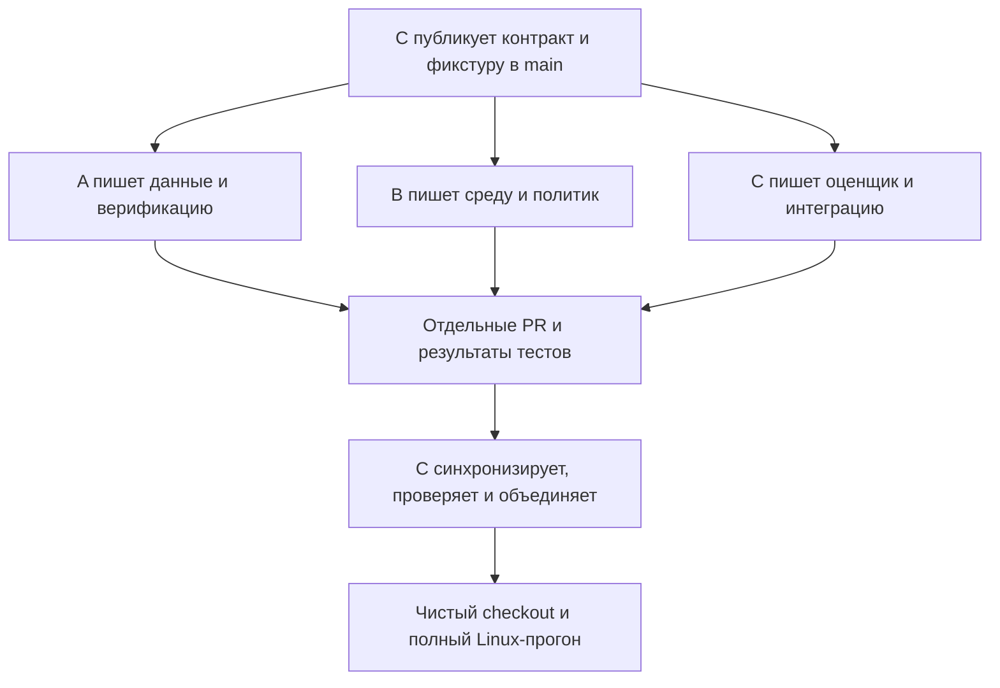

# Genesis FinTech: план сильной конкурсной работы
Подготовлено 20 ноября 2026 по финальному кейсу (6 страниц) и «Определениям проверок» от 20.11.2026. Цель — максимально полно доказать соответствие опубликованным критериям. Победу и фактические баллы заранее гарантировать нельзя.

## 1. Главная стратегия
Сделать компактную, воспроизводимую и проверяемую среду. На корректность контракта, данных и награды приходится 75 баллов; на воспроизводимость — ещё 15. Обучение весов необязательно; UI и высокая награда собственного агента отдельного балла не дают.
Рабочая концепция: «Каждое обвинение проверяется по доступным документам; каждое расхождение имеет воспроизводимую причину».
Сначала обязательное ядро, затем независимые доказательства его корректности, после этого краткое демо. Предлагаемое имя проекта: AuditLab Genesis.

| Блок | Баллы | Что создаём | Чем подтверждаем |
|---|---:|---|---|
| Контракт и изоляция | 25 | judge_adapter, reset/step, инструменты, state machine, ограниченный процесс политики | C01–C20; протокол и OS-проверки доступа |
| Данные и эталон | 25 | Согласованная история, четыре независимых типа, два сочетания, чистые случаи | D01–D20; независимый пересчёт до/после и доказательств |
| Надёжность награды | 25 | Строгий валидатор, максимальное паросочетание, точная reward | R01–R20 и дополнительные M01–M12 |
| Воспроизводимость | 15 | Детерминированная генерация/reset, загрузка episode_dir, преобразования | P01–P20; обратное отображение ID и равные inspection_steps |
| Инженерия | 10 | Один запуск, версии, траектории, разбор сбоя, ограничения | E01–E05, каждый 0/1/2 |
Локальный ориентир: 25*c/20 + 25*d/20 + 25*r/20 + 15*p/20 + сумма(e).
Это только оценка по локальным аналогам; скрытые значения и решение жюри неизвестны. Один провал C/D/R стоит 1.25 балла, P — 0.75, поэтому исправление пограничного теста обычно полезнее декоративной функции.

Блокирующие нарушения: утечка закрытых данных, запись в оценщик, реальные финансовые данные, неработающее ядро. При них оценивание блокируется до исправления в опубликованное организаторами окно.

## 2. Что именно строить
Начни с [архитектуры с диаграммами](ARCHITECTURE.md). Она объясняет один эпизод от счёта и платежа до решения оценщика, задаёт критерии принятия внешнего генератора и протокол сравнения политик.

| Очередь | Действие | Условие перехода |
|---|---|---|
| 1. Решение по данным | До 90 минут на малый срез R3n0va, фиксированный commit, DQ выключен. Проверить повтор по seed и связи счёт → платёж → проводки | В G0 записаны commit, команды, проверенные таблицы и решение об адаптации или собственном генераторе |
| 2. Числовой контракт | Для четырёх типов и двух сочетаний вручную вывести изменение, сумму в minor units, затронутые ID и полный набор публичных доказательств | Чистая версия согласована, ошибочная доказывается, взаимодействия имеют отдельные причины |
| 3. Первый прогон | Чистый случай, дубль и пропуск распределения. Подключить скриптовую сверку и сохранить траекторию | Reset → чтение → submit → проверка. Проверены правильный вывод, ложный вывод и closed reward |
| 4. Полнота и демо | Закрыть D/C/R/P, собрать комплект, показать чистый split-payment и почти такой же ошибочный эпизод | Проверка из чистой сборки, два режима, 10 train и 10 dev, отчёт ошибок и ограничения |
| 5. Эксперимент с политикой | После готового обязательного комплекта сравнить простую сверку с проверкой доказательств. При наличии времени попробовать imitation и RL на CPU | Одинаковые held-out эпизоды и лимиты, результат по каждому типу и FP на чистых, реальные шаги и время |

Для эксперимента с политикой раздели компании и их производные между train/dev/held-out. Зафиксируй held-out до настройки. Сравнение проходит на одинаковых эпизодах и лимитах, включая записанное несовпадение F1 и стоимости действий. Обучение и его результаты выводятся отдельно в отчёте. Официальная награда и режимы продолжают следовать кейсу.

Эпизод — одна синтетическая компания за один отчётный период. Основной стек: Python 3.11, stdlib для Decimal/CSV/JSON/дат/арифметического parser, минимальные фиксированные зависимости для разработки. Не вводить сервисы БД или API ради простого чтения записей.
Базовый размер для быстрого цикла: около 240 проводок и 40–80 документов; стресс-тесты до 2000 проводок/200 документов. Это наше проектное решение внутри предложенного диапазона, не новое требование жюри.

Генерация: хозяйственные события → согласованные документы и двойные записи → проверка исходной корректности → управляемая мутация → запись provenance → независимый пересчёт → truth.
Сохранять баланс дебета/кредита недостаточно: неверная двойная запись тоже может быть сбалансированной. Проверять обязательство, распределение, курс и период отдельно.

| Тип, проектное имя | Причинная мутация | Что нужно доказать публично |
|---|---|---|
| duplicate_invoice | Одно обязательство отражено повторно отдельным сбалансированным набором проводок | Один исходный invoice, обе группы отражения; совпадение суммы само по себе недостаточно |
| payment_allocation | Сумма фактического платежа верна, распределение пропущено или уменьшено | payment, invoice_refs и документированные поля распределения, соответствующие проводки |
| fx_conversion | Применён неверный курс/дата при отражении в базовой валюте | Документ с валютой/суммой/временем, нужная строка FX, policy, проводка результата |
| period_cutoff | Операция признана не в положенном периоде | Дата хозяйственного события, дата признания, timezone и публичные границы периода |

Дополнительные поля allocation_minor, currency_exponent, recognition_at и идентификаторы групп проводок допустимы только после документирования схемы, без признаков truth. Первоначальный G0 должен проверить, что каждый тип действительно доказуем по разрешённым таблицам и документам.

Два обязательных взаимодействия — проектный выбор:
1. Частичное распределение валютного платежа + неверный курс. Платёж и распределение независимы; ожидаемые суммы считаются по явной конвенции G0.
2. Повторное отражение invoice + отнесение одной группы отражения к неверному периоду. В публичных данных доступны исходный invoice и обе группы, а не потерянный за границей документ.
Для обоих выбрать канонические affected_ids и раздельные расхождения до генерации. Если одна мутация делает вторую недоказуемой или обе объясняют одно и то же изменение без ясного разложения — сценарий переработать. Это не дополнительный пятый тип ошибки.

Чистые случаи: обычная сверка, корректный split-payment, возврат, одинаковые суммы разных законных операций, корректная валютная/периодная граница. Все пять с пустым truth.
Настройки типов независимы; порядок/ID/суммы/валюты/таймзоны и комбинации меняются без кодирования ответа в префиксах ID.

## 3. Порядок реализации и условия перехода
### G0: контракт зафиксирован
T00. Сделать схемы manifest, policy, всех таблиц, findings, truth, provenance и интерфейс judge_adapter.py. Зафиксировать бухгалтерскую схему, направление FX, exponent и округление, период [start,end) как наше соглашение, canonical affected_ids, публичную адресацию evidence и отсутствие коллизий.
Проверить на бумаге четыре маленьких примера: какие документы читает политика и как вручную пересчитать ожидаемую сумму. Полный evidence-набор не более 10 ID; расследование демонстрационной политикой помещается в 100 действий. До этого не распараллеливать меняющиеся схемы.

### G1: рабочий вертикальный срез
T01. Минимальная чистая компания + дубль + пропущенное распределение; reset → list/get → submit → закрытая оценка; одна корректная и одна ложная находка; сохранённая траектория.
Сразу заложить разделение политики и оценщика. Версия без OS-изоляции допустима как внутренний прототип, но не как готовый результат C20.
Переход: исходные данные согласованы, правильный ответ выше пустого на ошибочном эпизоде, closed ничего не раскрывает.

### G2: все данные и строгий оценщик
T02 и T04 можно вести параллельно с T03 после G0/G1. Реализовать четыре типа, пять чистых сценариев, два взаимодействия и строгие правила matcher.
Переход: локальные D01–D20 и R01–R20/M01–M12 проходят с независимой проверкой чисел; truth не является единственным доказательством истинности.

### G3: ограничения и воспроизводимость
T03/T05/T06. Проверить 99 исследований+submit, 100 исследований, неверные ID/args/actions, timeout политики, immutable final, повторный reset, курсоры, безопасную Decimal-арифметику.
P01–P05 меняют порядок; P06–P10 меняют ID; P11–P20 меняют оба. Переносятся все связи, включая приватную часть на стороне оценщика. Списки line_items не перемешивать как будто они не имеют смысла.
Переход: C/P локально проходят; нельзя засчитать изоляцию лишь по отсутствию слова truth в одной строке.

### G4: сдаваемый пакет
T07/T08. Четыре адаптера базовых политик; 10 train и 10 dev, траектории, версия/config, результаты, README, лицензия, контейнер, записка, демо. Oracle имеет truth только на стороне оценщика.
Финальная команда проверки после подготовки образов — `bash scripts/verify.sh`. Скрипт запускает проверяющий контейнер и контейнер политики через Compose, возвращает код проверки и останавливает оба сервиса.
Проверить из чистого checkout/распакованного пакета. Создание образа и разрешённых dev-зависимостей отделить от официального запуска; runtime сети не требует, образ не скачивает модель/пакеты на старте.
Переход: документация совпадает с реально выполненной командой и отсутствуют блокирующие нарушения.

## 4. Где добавить уникальность
В критериях нет отдельной строки за оригинальность. Отличие должно усиливать проверяемые свойства среды.

| Дополнение | Минимальная реализация | Польза и ограничение |
|---|---|---|
| Причинный паспорт эпизода | В закрытом отчёте: исходное событие → мутация → сумма → доступные доказательства → независимый результат | Усиливает доверие к D и инженерии; политика паспорт не видит |
| Проверка устойчивости | CLI создаёт пары, переносит ID, сравнивает oracle-метрики и reward, сохраняет воспроизводимый сбой | Закрывает P; не требует неизменной траектории произвольного агента |
| Паспорт защиты награды | Таблица «правильный / молчание / дубли / массовая пометка / guessed ID / лишнее evidence» с expected/actual | Доказывает R; общая функция reward не меняется |
| Контрфактическое исправление — только после G4 | На закрытой стороне убрать одну мутацию и независимо проверить исчезновение именно её расхождения | Сильное демо причинности; не часть observations и не новая обязательная задача |
| Читаемый просмотр готовой траектории — последним | Статический HTML/CLI из уже сохранённого журнала | Помогает объяснению; не заменяет тесты и не должен смешивать приватные и публичные журналы |

Приоритет: первые три встроить в обычные отчёты, без отдельного большого продукта. Не тратить срок на RL-training, RAG, OCR, multiagent-аудитора или веб-приложение, пока G4 не закрыт.

## 5. Рабочие агенты и разделение ответственности
Для трёх отдельных пользователей применяется распределение A/B/C ниже и в ARCHITECTURE.md. Таблица в этом разделе описывает функции для работы из одной сессии.
Координатор — текущий основной агент. Он держит схему, общие файлы, интеграцию и очередь.
Это агенты разработки. Они отличаются от политик-участников RL-среды.

| Роль | Владеет | Не меняет самостоятельно |
|---|---|---|
| data_engineer | src/genesis_audit/data/, tests/data/ | matcher, OS-границу, общие схемы |
| env_engineer | src/genesis_audit/env/, sandbox/, tests/contract/ | truth, правила сумм и matcher |
| reward_engineer | src/genesis_audit/scoring/, tests/scoring/ | генератор, reward-формулу, API жюри |
| verifier_engineer | src/genesis_audit/verification/, tests/verification/, reports/ | production matcher, generator для подгонки результата |
| reviewer | отчёт координатору; без правок реализации | всё исполняемое ядро |

Сначала координатор закрывает G0, затем максимум три независимых автора. Verifier может писать фикстуры по замороженному контракту, не дожидаясь всей реализации. Reviewer подключается к стабильному срезу.
Все изменения общих схем идут через координатора и повторную проверку затронутых модулей. Один путь — один автор. Независимость verifier означает отдельный пересчёт семантики, а не вызов oracle→matcher.

Пакет задачи агенту: ID задачи; версии входного контракта; файлы-владения; критерии; примеры; команда проверки; что не входит в scope. Ответ: diff/файлы, результаты, ограничения, следующий риск.
При отсутствии custom roles координатор передаёт инструкции из agent-config/agents/*.toml через обычный spawn_agent. При отсутствии subagents идёт по той же очереди последовательно.

## Параллельная работа трёх пользователей через GitHub

Этот режим использует трёх самостоятельных исполнителей. A берёт data_engineer и verifier_engineer, B берёт env_engineer, C — reward_engineer и координатора. Независимый review конкретного PR делает участник, который его не писал. Наличие общего чата или subagents для работы не требуется.



| Этап | Как передаём результат без чата |
|---|---|
| G0 | C открывает bootstrap PR и публикует в нём пути, схемы, команды, фикстуру и распределение ролей. После merge A/B/C фиксируют один SHA основы. До merge A/B могут изучать кейс и готовить сценарии в своих ветках, опираясь на готовый контракт только после его фиксации |
| G1 | A/B/C одновременно открывают небольшие PR для ручного сценария, каждый со своими тестами. Объединение проходит последовательно через C. На `main` общие тесты должны оставаться зелёными, а сквозной тест добавляется с интеграцией готовых частей. Блокирующую зависимость записывают ссылкой на PR |
| G2–G3 | A ведёт типы ошибок, независимую проверку и преобразования. B ведёт лимиты, изоляцию и обычные политики. C ведёт сопоставление, oracle и сборку. В отчётах PR указывают базовый SHA, версию контракта, команды и результаты. Остальные читают принятые изменения через `git fetch` |
| G4 | C собирает релиз из чистого checkout. A или B отдельно повторяет запуск по README и оставляет фактический результат в PR. C фиксирует финальный SHA и вложения |

Ветка принадлежит одному участнику, например `work/data-t02`, `work/env-t03`, `work/scoring-t04`. Для общей ветки `main` настройте при доступности PR, обязательные проверки и запрет force-push. Единственный пользователь, который объединяет рабочие изменения в `main`, — C. Если правила GitHub недоступны, этот порядок выполняется вручную. Каждый участник отправляет свои коммиты только в свою ветку.

**Перед PR и после обновления `main`.** Сохрани собственные правки коммитом, затем из своей рабочей ветки выполни:

```bash
git fetch origin
git log --oneline HEAD..origin/main
git diff --name-status HEAD...origin/main
git diff --name-status origin/main...HEAD
git merge --no-edit origin/main
```

Первая разница показывает изменения, пришедшие из `main` от общей базы. Вторая показывает изменения твоей ветки. Перед слиянием посмотри отдельно общие схемы, адаптер и changelog контракта, если он появился. После слияния повтори тесты роли и отправь свою ветку обычным `git push`. Если конфликт затронул чужой файл или схему, сообщи в PR путь, два SHA, минимальный пример и ожидаемое решение. Пока C не принял решение, можно вернуть ветку в состояние до начатого слияния командой `git merge --abort` и продолжать независимую часть. Используй эту команду только после начала конфликтного merge и при сохранённых перед merge изменениях.

Каждый PR содержит задачу, роль, базовый SHA, версию схемы, изменённые пути, команды со статусами и зависимости. Если тесты не запускались, укажи причину. После принятия PR C сверяет текущий `main` ещё раз перед следующим merge. При несовместимой схеме сначала принимается отдельный PR контракта с тестовой миграцией, затем обновляются ветки зависимых модулей. Если нужный PR пока открыт, работа по текущей версии продолжается с зафиксированным контрактом и тестовыми данными.

См. [правила защиты веток GitHub](https://docs.github.com/en/repositories/configuring-branches-and-merges-in-your-repository/managing-protected-branches/about-protected-branches) и [git merge](https://git-scm.com/docs/git-merge).

## 6. Срок до сдачи
По предоставленному кейсу: 22 ноября 2026, 23:59 по Астане. Время таблицы — местное для Астаны/Кызылорды; это план распределения, а не обещание производительности. Если старт позже — сокращать дополнения, а не проверки.

| Окно | Результат |
|---|---|
| Вечер 20 ноября, первые 2–3 рабочих часа | G0 и начало вертикального среза |
| 21 ноября, первая половина дня | G1; параллельная работа над четырьмя типами, средой и matcher |
| 21 ноября, вторая половина дня | G2, базовая OS-изоляция и локальная матрица |
| 22 ноября, до 14:00 | G3; независимые D и P, четыре политики |
| 22 ноября, 14:00–19:00 | G4; пакет, траектории, измеренный сбой и исправление |
| 22 ноября, 19:00–21:00 | Чистый запуск и независимый review |
| 22 ноября, после 21:00 | Только блокирующие исправления, повтор соответствующих проверок; резерв на сдачу до 23:59 |

Если один разработчик: идти T00→T01→T04→T02→T03→T05/T06→T07/T08; планировать по факту. Наличие нескольких агентов не ускоряет зависимые интерфейсы.
Сбой контейнера/изоляции — критический риск, поэтому проверка доступности runtime входит в T00. Наличие WSL/VM/Docker уточнять по фактам; установка и настройка внешней среды не считаются уже выполненными.

## 7. Демонстрация на 3–4 минуты
1. 20–30 сек: задача среды и пять блоков оценки; одна команда запуска.
2. 45–60 сек: синтетическая история, одна причинная ошибка, доступные документы и итоговый finding.
3. 40 сек: closed reward=0 у политики и отдельный результат у оценщика; отсутствие доступа к закрытым файлам.
4. 40 сек: правильный ответ, дубли и массовая пометка с ожидаемой и фактической reward.
5. 40 сек: смена ID/порядка сохраняет oracle-метрики; отчёт независимого verifier.
6. 20–30 сек: настоящий найденный сбой, исправление/ограничение и повторная проверка.
Не говорить «модель стала лучше» без специального эксперимента. Ясно назвать ограничения синтетического мира и область применимости.

## 8. Финальный комплект
- Отдельно проверить два способа входа: наша полная проверка одной командой и импорт judge_adapter.py жюри в заявленной рабочей директории образа. Прогнать generate_episode → загрузка исходного/преобразованного episode_dir → reset/step → score_episode. Проверить, что адаптер не подменяет решения внешней политики.
- Исходники генератора/среды, лицензия, зафиксированные зависимости.
- README: рабочая директория, build, одна команда проверки, API адаптера, схемы, четыре типа.
- judge_adapter.py: generate_episode, make_env, score_episode.
- Четыре адаптера политик: seeded random, simple reconciliation, mark-all, evaluator-only oracle.
- 10 открытых train + 10 dev эпизодов; отдельные namespaces seed/config; приватные файлы не монтируются политике.
- Код matcher/normalization/tolerance/tie-break и общей reward; фикстуры C/D/R/M/P.
- trajectories.jsonl: episode_id, step, action, observation, reward, terminated, truncated; без truth в observations.
- Отдельный закрытый отчёт качества: P/R/F1/return/steps/time по политикам и сценариям.
- DESIGN.md: архитектура, бухгалтерская модель, причинные мутации, изоляция, ограничения.
- Демо скриптовой политикой; обучение весов не требуется.
- Лог чистого воспроизведения и измеренного разбора сбоя.
- Проверенный размер пакета, отсутствие реальных/личных данных и внешних runtime-зависимостей.

Готовность RL-среды для сдачи подтверждают интерфейс, работающий скриптовый агент, траектории с терминальной наградой в train и закрытое вычисление метрик в closed. Обучение весов не является условием готовности. Если после этого делаем эксперимент, отдельная задача включает дополнительные эпизоды, baseline, тренировочный цикл, фиксацию весов и сравнительный отчёт на held-out по протоколу ARCHITECTURE.md.

## 9. Честное состояние подготовки
Созданы план, исходные тексты и инструкции. Среда пока не реализована, баллы не измерены. Полная матрица находится в ACCEPTANCE_MATRIX.md; TODO не является пройденной проверкой.
Конфигурации ролей подготовлены в agent-config. Автоматическая проверка разрешений запретила запись в .codex, поэтому custom roles не установлены; доступное обычное делегирование используется через AGENTS.md.

